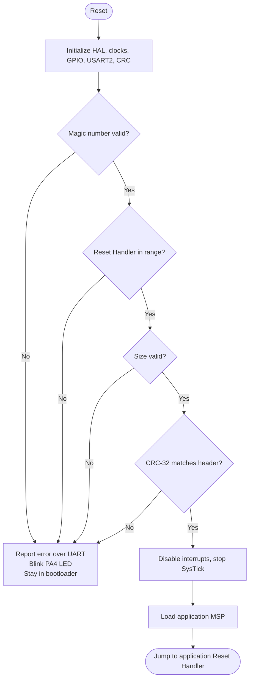

# STM32F446RE Custom Bootloader

A from-scratch bootloader for the **STM32F446RE** (Cortex-M4) that validates an application image in internal Flash using header metadata and a **hardware CRC-32** before handing over execution. If validation fails, the application is never started.


---

## Table of Contents

- [Overview](#overview)
- [Features](#features)
- [Memory Layout](#memory-layout)
- [Boot Flow](#boot-flow)
- [Application Header](#application-header)
- [Application Validation](#application-validation)
- [CRC-32 Implementation](#crc-32-implementation)
- [Build and Metadata Workflow](#build-and-metadata-workflow)
- [Bootloader-to-Application Handoff](#bootloader-to-application-handoff)
- [Testing](#testing)
- [Repository Structure](#repository-structure)
- [Known Limitations](#known-limitations)
- [Roadmap](#roadmap)
- [Tools and Technologies](#tools-and-technologies)

---

## Overview

The project is split into two independent firmware images:

- **Bootloader**: runs first after reset, checks that a valid application exists, and jumps to it.
- **Application**: linked at a non-default Flash address, carries a metadata header, and relocates its own vector table on startup.

The goal is a clear, minimal, and verifiable foundation for secure and fault-aware boot. It is also the groundwork for a larger flight-computer firmware project.

## Features

- Separate bootloader and application projects
- Custom Flash partitioning with a dedicated application-header region
- Application linked at a non-zero address (`0x0800C000`)
- Header validation: magic number, Reset Handler address, and image size
- **Hardware CRC-32** verification using the STM32 CRC peripheral
- Header-free binary generation for CRC calculation (`objcopy --remove-section=.header`)
- Python utility that computes image size and CRC using the same convention as the hardware peripheral
- Controlled handoff: SysTick stop, interrupts disabled, MSP load, jump to Reset Handler
- UART status and error reporting, plus an LED indicator (PA4) on validation failure

## Memory Layout

| Region | Start Address | Size | Flash Sectors |
|---|---:|---:|---|
| Bootloader | `0x08000000` | 32 KB | 0-1 |
| Application Header | `0x08008000` | 16 KB | 2 |
| Application Image | `0x0800C000` | 464 KB | 3-7 |

```text
0x08000000 ┌──────────────────────────┐
           │ Bootloader        (32 KB)│
0x08008000 ├──────────────────────────┤
           │ Application Header(16 KB)│  ← 12-byte header used, rest reserved
0x0800C000 ├──────────────────────────┤
           │ Application Image (464 KB)│  ← vector table starts here
0x08080000 └──────────────────────────┘
```

The region boundaries fall on STM32F446RE Flash sector boundaries, so each region can be erased independently (important for future update support). The layout is defined in `flash_layout.h` and mirrored in the application linker script.

## Boot Flow



## Application Header

The header lives in a dedicated `.header` linker section placed at `0x08008000`, separate from the application image.

```c
typedef struct
{
    uint32_t magic;
    uint32_t size;
    uint32_t crc;
} app_header_t;
```

| Field | Description |
|---|---|
| `magic` | Identifies a valid header. Expected value: `0xABCDEFAB`. |
| `size` | Application image size in bytes. |
| `crc` | Expected CRC-32 of the application image. |

The structure occupies 12 bytes of the reserved 16 KB region. The header is excluded from the CRC calculation so that the metadata never depends on the checksum it stores.

## Application Validation

`bootloader_is_app_valid()` runs the following checks in order and returns a status code:

| Code | Check | Meaning on failure |
|---:|---|---|
| `0` | None | Application is valid |
| `1` | Magic number | Header at `APP_HEADER_ADDR` does not contain `APP_MAGIC` |
| `2` | Reset Handler | Address at `APP_START_ADDR + 4` is outside the Flash range |
| `3` | Image size | Size is zero or exceeds `APP_MAX_SIZE` |
| `4` | CRC-32 | Computed checksum differs from the header value |

On success the bootloader calls `JumpToApplication()`. On failure it prints the matching error over UART and stays in the bootloader, blinking the PA4 LED.

## CRC-32 Implementation

The bootloader uses the STM32F446RE hardware CRC peripheral through the HAL.

- Polynomial: `0x04C11DB7`
- Initial value: `0xFFFFFFFF`
- Input: 32-bit words (image size must be a multiple of 4 bytes)

`CRC32_Calculate()` wraps `HAL_CRC_Calculate()` and runs over the image starting at `APP_START_ADDR`, for the length stored in the header.

> **Note:** this is the STM32 hardware CRC convention and is **not** the same as Python's `zlib.crc32()`. The host utility implements the hardware algorithm directly, and was cross-checked against the peripheral on a known test input.

## Build and Metadata Workflow

The application ELF contains two Flash regions (`.header` at `0x08008000` and the image at `0x0800C000`), so a plain `.bin` export is not suitable for CRC calculation. A post-build step generates a header-free binary:

```bash
arm-none-eabi-objcopy -O binary --remove-section=.header \
    "${BuildArtifactFileName}" \
    "${BuildArtifactFileBaseName}_app.bin"
```

Verify section placement at any time with:

```bash
arm-none-eabi-objdump -h F446_Application.elf
```

Expected output includes `.isr_vector` at `0x0800C000` and `.header` at `0x08008000`.

**Steps to produce a bootable image:**

1. Build the application; this generates `*_app.bin`.
2. Run the Python utility on `*_app.bin` to obtain the image size and CRC-32:
   ```text
   Application size: 9320 bytes
   Application CRC:  0x873987CF
   ```
   *(Example values from one build.)*
3. Enter the size and CRC in the `app_header` definition in the application source.
4. Rebuild and flash the bootloader and application.

Because `.header` is removed from the binary before the CRC is computed, updating the header values does not change the checksum.

## Bootloader-to-Application Handoff

`JumpToApplication()` performs the following:

1. Read the application's initial MSP from `APP_START_ADDR`.
2. Read the Reset Handler from `APP_START_ADDR + 4`.
3. Disable interrupts.
4. Stop SysTick.
5. Set MSP to the application's initial stack pointer.
6. Branch to the application's Reset Handler.

The application then sets `SCB->VTOR = APP_START_ADDR`, enables interrupts, initializes its peripherals, and enters its main logic.

## Testing

Tested on STM32F446RE hardware, observing behaviour over UART.

| Test | Expected behaviour | Result |
|---|---|---|
| Valid application | Validation succeeds; execution transfers to the application | ✅ Passed |
| Invalid CRC | Application rejected; CRC failure reported | ✅ Passed |
| Invalid magic number | Application rejected; magic failure reported | ✅ Passed |
| Invalid Reset Handler | Application rejected with code `2` | ⏳ Planned |
| Zero image size | Application rejected with code `3` | ⏳ Planned |
| Oversized image | Application rejected with code `3` | ⏳ Planned |
| Corrupted image, unchanged header | CRC mismatch detected | ⏳ Planned |

Sample output on success:

```text
Bootloader is running...
Application is running...
```

Sample output on CRC failure:

```text
Bootloader is running...
Failed to jump!
CRC check failed!
```

## Repository Structure

```text
.
├── bootloader/      # Bootloader project (STM32CubeIDE)
├── application/     # Application project (linked at 0x0800C000)
├── run.py           # Python utility: image size and hardware-compatible CRC-32
└── README.md
```

## Known Limitations

- Validates an application already programmed into Flash; no firmware download or in-field update yet.
- No fallback image or automatic recovery.
- The Reset Handler check currently only verifies the upper address byte; it does not check the full application range, the Thumb bit, or that the initial MSP points into RAM.
- `CRC32_Calculate()` returns `0` for invalid input, which is indistinguishable from a real CRC of zero.
- Image size must be a multiple of 4 bytes.
- Metadata (size and CRC) is entered into the header manually after each build.
- The CRC detects accidental corruption only. It provides no authentication or tamper resistance.

## Roadmap

- [ ] Stricter vector-table validation (MSP in RAM, Reset Handler within the application region, Thumb bit)
- [ ] Automate header generation as part of the build
- [ ] Complete negative-test coverage for every validation branch
- [ ] Separate error reporting from the CRC return value
- [ ] UART firmware download and in-field updates
- [ ] Version metadata in the header
- [ ] Dual-image layout with fallback and rollback
- [ ] Fault-aware boot and integration with a flight-computer firmware project

## Tools and Technologies

- STM32F446RE (Cortex-M4)
- STM32CubeIDE and STM32 HAL
- STM32 hardware CRC peripheral
- GNU Arm Embedded Toolchain (`arm-none-eabi-objcopy`, `arm-none-eabi-objdump`)
- Python 3
- UART terminal for status output
